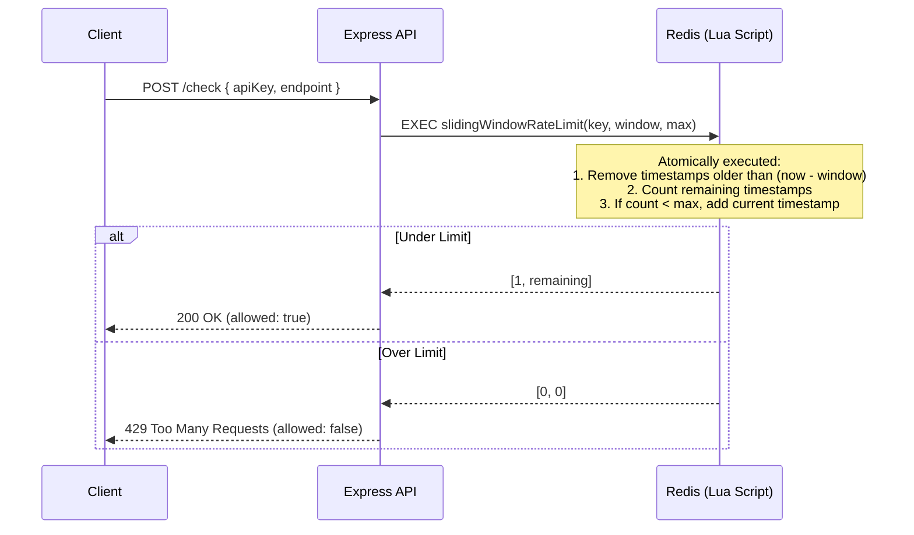

# Architecture: Rate Limiter Service Node

## Sliding Window Algorithm (Redis + Lua)

This service implements a highly accurate "Sliding Window" algorithm using Redis Sorted Sets (ZSETs).

## Design Decisions

### 1. Why Lua over multiple Redis commands?
If we executed `ZREMRANGEBYSCORE`, `ZCARD`, and `ZADD` as separate operations from Node.js, we would introduce a **race condition**. Two concurrent requests could both read a count of `99` and both write their timestamp, exceeding the limit of `100`. 
Redis evaluates Lua scripts atomically, ensuring that the entire check-and-insert sequence happens without interruption.

### 2. Time Space Complexity
- **Memory**: We store one timestamp (an 8-byte float in Redis) per request within the window. At 100 req/min, this is trivial. At 1M req/min, it could use substantial RAM. For massive scale, a "Sliding Window Log" might be replaced by a "Sliding Window Counter" or "Token Bucket" algorithm to save memory, but this implementation provides the highest accuracy.
- **Time**: `ZREMRANGEBYSCORE` is O(log(N) + M) where M is the number of elements removed. Since we run this frequently, M is typically 0 or 1, making it highly efficient.
